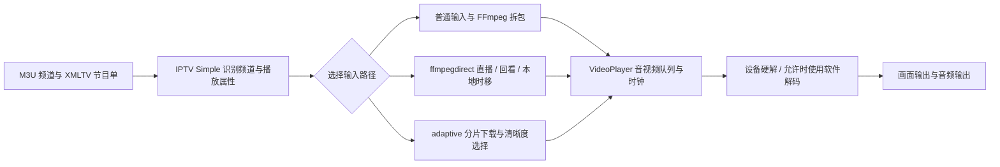

# Kodi 直播源码分析与内核选择

日期：2026-09-08。状态：完成直播主链路的第一轮静态分析；未构建 Kodi，未运行其 Android 版，未进行真实源对照。不是对整个 Kodi 仓库所有功能的逐行审计。TiviMate 仍有受保护、无法确认的部分。

## 结论

可以直接采用成熟开源播放组件，不需要从头编写视频解码器。但不能把“TiviMate 的私有实现”“它包含的 Media3”“Kodi 的 VideoPlayer”和“FFmpeg”当作同一个东西。

| 方案 | 能否直接接入 kantv | 当前判断 |
|---|---|---|
| TiviMate 私有播放器封装 | 未取得完整源码，也未确认有公开 SDK | 不作为可直接借用的组件；继续参考已经观察的交互和实测表现 |
| AndroidX Media3 / ExoPlayer | 有正式 Android 依赖；可以配自己的页面 | 建议作为第一套候选；要实现源适配、恢复和诊断，不能仅用默认参数就承诺达到 TiviMate 体验 |
| Kodi VideoPlayer | 源码开放，但依赖 Kodi 主程序、音频引擎、窗口与渲染、设置和插件服务 | 可以研究、修改或工程化移植；本次未找到可直接替换成普通 Android 播放组件的独立 AAR 接口。提取工作明显大于接入已有 SDK |
| 完整 Kodi 分支加自定义外观 | 能保留较完整的 Kodi 播放链路 | 会变成基于 Kodi 的产品分支，和当前独立新建的 kantv 路线不同；不默认改变项目方向 |
| LibVLC | VideoLAN 官方提供 Android 库和 AAR 接入方式 | 可作为兼容性对照候选；它是 VLC 的内核，不是 Kodi 内核。本轮只核实官方集成资料，未下载/构建/测它 |

建议先采用独立页面加可替换播放适配层，用 Media3 完成第一套可安装播放样机；与原版 TiviMate、Kodi 在同设备同源上对比。若特定协议、隔行或软解能力有明显缺口，再以 LibVLC 做第二套对照。暂不做两套内核同时运行或自动反复切换，更不声称已经选出播放性能冠军。内核选择建议尚非用户确认。

依据：[Media3 官方依赖发布页](https://developer.android.com/jetpack/androidx/releases/media3)、[VideoLAN 官方 LibVLC 说明](https://github.com/videolan/vlc-android#libvlc)。后者一些构建说明仍提旧仓库；这里只采用其提供可嵌入库的事实，未照抄旧构建命令或锁定预发布版本。

## 已下载并冻结的材料

| 材料 | 版本 / 提交 | 本地位置 |
|---|---|---|
| Kodi Android ARM64 APK | 21.3，包 org.xbmc.kodi，versionCode 2103000；min API 21，target 34 | `reference/kodi/packages/kodi-21.3-Omega-arm64-v8a.apk` |
| Kodi 核心源码归档 | 标签 21.3-Omega；a3a448d26b8d560a65655dab2cd122994dc4e146 | `reference/kodi/sources/xbmc-21.3-Omega/` |
| IPTV Simple | Omega 分支，21.11.0；5a438f6223a7ccbff3626e17792ebb5b8b08efcf | `reference/kodi/sources/pvr.iptvsimple-5a438f6223a7ccbff3626e17792ebb5b8b08efcf/` |
| inputstream.ffmpegdirect | Omega 分支，21.3.8；3c596496d2360f7b25ff58886a81cb1273266481 | `reference/kodi/sources/inputstream.ffmpegdirect-3c596496d2360f7b25ff58886a81cb1273266481/` |
| inputstream.adaptive | Omega 分支，21.5.24；6ce0f1719e1f599dc89d5a7952839fd1d95a5d1a | `reference/kodi/sources/inputstream.adaptive-6ce0f1719e1f599dc89d5a7952839fd1d95a5d1a/` |
| Media3 源码归档 | 标签 1.11.0 | `reference/media3/media-1.11.0/` |

插件是本次冻结的 Omega 分支快照，不声称和 Kodi 21.3 发布日打包版本一致；IPTV Simple 的插件依赖声明要求输入插件至少 21.0.0，不等于这组二进制已经安装兼容。未混用 Kodi 22 开发分支。

官方下载入口：[Kodi Android](https://kodi.tv/download/android/)。核心来自官方 GitHub 标签，插件来自 kodi-pvr / xbmc 官方仓库。归档完整保留；仅展开普通文件、目录供阅读，未执行第三方构建脚本，未拉取所有外部构建依赖。

下载大小与 SHA256 保存在 `reference/kodi/evidence/manifest.json`。Kodi APK SHA256：`34e7526705a038fa12f70161d0c1cc38f10deb0fee305b46fbd46ff015d05b44`。APK v1/v2/v3 签名检查通过；未独立对照开发者证书，不能把签名自检说成完整供应链认证。

## 直播不是一个单独的解码器

具体走哪条输入路径由频道属性、协议、设置和已安装插件共同决定；不是每条直播都会经过全部插件。节目单和台标提供显示资料，不会直接使视频传输更流畅。

## 查到的关键播放策略

下面的编号供后续实现与测试追踪。K 表示 Kodi 核心目录；P 表示 IPTV Simple；F 表示 ffmpegdirect；A 表示 adaptive；M 表示 Media3。行号均对应上表冻结源码。

| 编号 | 源码证据 | 实际作用与使用边界 | kantv 建议 / 验收 |
|---|---|---|---|
| S01 输入选择 | K `xbmc/cores/VideoPlayer/DVDInputStreams/DVDFactoryInputStream.cpp:38`；P `src/IptvSimple.cpp:227` | 先按属性、已启用插件与类型选输入；不能只看网址后缀 | 导入时保存协议/MIME/源属性；测试无扩展名、带重定向的源，P2 |
| S02 请求与重连 | K `xbmc/filesystem/CurlFile.cpp:645`、`:1682`；F `src/stream/FFmpegStream.cpp:2361` | 有连接超时、受限重试、部分 Range 失败处理；不同输入层的策略不同 | 请求头按源隔离；断网、超时、403 分别处理，P2；不能把所有错误无限重试 |
| S03 首播与再缓冲 | K `VideoPlayer.cpp:1865`；M `DefaultLoadControl.java:766`、`:812` | Kodi 有 FULL/INIT/PLAY/DONE 状态，直播还看音频队列；Media3 区分开始播放和卡顿后恢复阈值，并考虑内存上限 | 起播速度与连续稳定性分别测；不能把“最大缓存”当“必须等满才播放”，P2 |
| S04 直播延迟 | K `VideoPlayer.cpp:1979`；M `DefaultLivePlaybackSpeedControl.java:336` | Kodi 实时分支根据音频队列调整时钟；Media3 可在再缓冲后增大目标直播偏移并调速 | 对具备直播时间线的 HLS/DASH 评估；普通直出 TS 不能强套直播窗口参数，P2/P4 |
| S05 换台与退出 | K `VideoPlayer.cpp:667`、`:701` | 已运行时传递打开消息；关闭时中断拆包/输入并等待线程清理 | 采用独立会话编号，快速按键只保留最终选择，旧失败不得覆盖新频道，P2 |
| S06 预连接/预拉流 | 本轮未证明 TiviMate 或 Kodi 默认预拉相邻台；M `DefaultLoadControl.java:832` 有预加载协调入口 | 有预加载能力不等于已为直播邻台启用；消耗连接数和带宽 | 首期不默认预拉多台；源允许后单独对照，P4 |
| S07 探测与异常码流 | K `DVDDemuxers/DVDDemuxFFmpeg.cpp:504`、`:1048` | 按格式调整探测；对 HEVC TS 有专门分支；区分暂时无包和 EOF | 保留按源适配，不全局缩短探测或任意放宽关键帧；测试 H.264、HEVC、TS、HLS，P2/P4 |
| S08 硬软解 | K `DVDCodecs/DVDFactoryCodec.cpp:44`；`DVDCodecs/Video/DVDVideoCodecAndroidMediaCodec.cpp:327` | 平台硬解注册；只有允许 fallback 或强制软件等条件下才进入 FFmpeg 软件视频路径，外部解码插件另有路径 | 硬解优先，软件解码是否流畅依设备与分辨率；不能承诺 4K 软解，P2/P4 |
| S09 时间戳与音画同步 | K `VideoPlayer.cpp:2297`；`VideoPlayerAudio.cpp:527`、`:586` | 判断时间戳前跳/后跳，确认后修正；音频输出可选择同步/重采样策略，直通有不同约束 | 记录错位方向与时长，测广告切换、音轨切换、连续播放，P4 |
| S10 帧节奏与隔行 | K `VideoPlayerVideo.cpp` 的帧率统计/丢帧处理；Android MediaCodec 实现 | 帧率不匹配、解码丢帧和网络断流不是同一问题；有处理分支不保证设备隔行效果 | 重点测体育/滚动字幕、1080i 与 50fps；刷新率切换引起的黑屏另计，P4 |
| S11 自动清晰度 | A `src/common/ChooserDefault.cpp:160`、`:187` | 平滑最近下载速度并结合屏幕/带宽限制选已有码率档 | 仅当源提供多个档位时有效；不能把单码率频道凭空变成多码率，P4 |
| S12 分片故障 | A `src/common/AdaptiveStream.cpp:379` | 直播分片有限重试，字幕缺片单独处理；代码还注明重试间隔和停止打断的改进点 | 借鉴分类恢复，参数重新测；不把成熟项目全部默认策略照搬，P2/P4 |
| S13 备用地址 | 本轮未确认参考软件有满足 kantv 要求的自动择优流程 | 没有源清单和同频道映射，无法保证备用地址有效 | 用户提供多源后按频道识别、连接限制与失败类型设计，P4 |
| S14 页面与播放生命周期 | K VideoPlayer、RenderManager、ServiceBroker 之间的调用 | 播放器不是只属于某一个列表页；UI、输出与线程寿命有关联 | 打开设置/频道列表继续播放；退出与重进释放/恢复正确，P2 |
| S15 状态保存 | P 的频道资料与播放属性可读；本轮未完成 Kodi 全部持久化路径审计 | 元数据恢复与复用一条过期流地址是两回事 | 保存稳定频道标识；再次进入重新解析当前地址，P2 |
| S16 资源管理 | K `xbmc/filesystem/FileCache.cpp:244`；F `TimeshiftBuffer.cpp:156` | 读取节流、内存/磁盘段管理；时移清理有暂停和读取位置条件 | 内存、磁盘、温度、后台任务独立设限；暂停状态下也要实测空间耗尽，P4/P5 |
| S17 诊断与隐私 | 参考代码有 URL 脱敏日志调用，也存在输出属性的日志 | 不能假设第三方默认日志已满足本项目的凭据保密要求 | 仅记录随机频道编号、事件、耗时和错误类别；真实 URL/请求头不进日志，P2 |
| S18 回看/时移/录制 | F `src/StreamManager.cpp:210`；P `src/IptvSimple.cpp:345`、`:392` | 回看与本地时移是独立类；IPTV Simple 的 Recordings 接口还可用于已有媒体列表 | 按下文分开实现、验收；不能把出现“录制”接口认定为能录当前直播，P5 |

上表省略的 K 播放文件均位于 `xbmc/cores/VideoPlayer/`；M 文件位于 `libraries/exoplayer/src/main/java/androidx/media3/exoplayer/`。源码位置用于工程复查；表内 kantv 行为均是建议，未实现。

**两个容易误读的数值例子：** Kodi FULL 缓冲状态某一路径检查缓存时间超过 8 秒，但实时流另有按音频队列的放行条件，这不是“所有直播先等 8 秒”。Media3 1.11.0 中默认网络首播阈值为 1000ms、再缓冲为 2000ms，加载缓存上下界默认 50000ms；真实出画时间还取决于请求、探测、关键帧和解码初始化。这些不是 TiviMate 的已知参数，也不是 kantv 已选参数。

## 为什么不能直接复制 Kodi 的播放器目录

K `xbmc/cores/VideoPlayer/CMakeLists.txt` 使用 `core_add_library(VideoPlayer)`；顶层 `CMakeLists.txt:428` 组装主共享库。`VideoPlayer.cpp:641–656` 需要 DataCache、ProcessInfo、WinSystem，打开/关闭还操作 RenderManager。输入工厂需要 AddonManager；音频涉及 AudioSinkAE。插件继承 Kodi 的 `CInstanceInputStream`，并依赖 Kodi 的文件系统、设置与数据包分配接口。

所以源码开放意味着“可基于它工程化改造”，不意味着复制一个文件夹或 APK 中的 `.so` 就能在自有 Activity 播放。能否做独立桥接库需另建移植样机，补齐运行时服务、生命周期和二进制接口，且持续跟进上游变动。本轮没有做这项移植，也没有证明存在不可解决的技术障碍。

Kodi 核心及本次三个插件声明 GPL-2.0-or-later；Media3 仓库为 Apache-2.0，外部原生组件另核对。采用时保留相应许可和来源记录。当前只研究，没有把参考产品受保护代码混进应用。

## 三种功能的区别

| 功能 | 数据从哪里来 | 设备 / 存储条件 | 不能误认为 |
|---|---|---|---|
| 回看 | 源服务已经保存的历史节目，通过时间或节目 ID 请求 | 服务有可用回看窗口、地址规则和权限；客户端存储通常不是主要条件 | 有 EPG 就必然有历史视频 |
| 直播暂停与本地时移 | 从打开频道后不断接收并保存的数据 | 写入能力、空间、清理规则；在设备睡眠/退出时需定义行为 | 可以回到开始保存之前 |
| 录制 | 主动保存直播内容供稍后使用，或访问服务端录制 | 存储空间、持续运行、预约唤醒能力、并发连接数；保存与播放路径独立验收 | 时移缓存等于永久录像，或“Recordings”栏目等于录像功能 |

ffmpegdirect 的本地时移使用分段内存和磁盘；不能直接当作 kantv 的容量安全方案。IPTV Simple 的回看代码会判断源能力与时间窗口；其已有媒体通过 Recordings 接口展示，不代表插件本身已提供通用直播预约录像机。

## 与 TiviMate 的比较边界

TiviMate APK 中确认有 Media3 类和 FFmpeg 相关库，但保护层使业务策略不可完整读取。没有证据证明其邻台预拉、具体缓存阈值、备用源策略、服务端预转码或完整视频软解路径。本轮不声称破解完成。

Kodi 可读源码证明成熟播放器会在输入、缓冲、时间戳和输出等多个环节处理问题。用户观察到 TiviMate/Kodi 较少卡顿具有参考价值；仍需同设备、同地址、同请求头、同网络、相近时段对比，才能排除服务端负载、源地址变体、直播延迟不同造成的差异。

Media3 官方 FFmpeg 扩展用于音频，不是通用 H.264/HEVC 软件视频解码补丁；MediaCodec 的 decoder fallback 也只是在可用解码器间尝试。不能靠一个开关宣称获得 Kodi 全部解码能力。依据：[官方格式说明](https://developer.android.com/media/media3/exoplayer/supported-formats)，以及本地 `libraries/decoder_ffmpeg/README.md:1`、`MediaCodecRenderer.java:1291`。

## 下一步验收和未完成项

- 原型操作继续随用户测试修正；不要求重新确认已回答的需求。
- 建立独立 Android 播放样机；相同源依次测 Media3、TiviMate、Kodi，受限账号不并发播放。
- 分别记录请求到首帧、首次出声、换台 P50/P95 和失败数、卡顿次数/总时长、直播延迟、丢帧、音画差、断网恢复、CPU/内存/温度。快进度不以更大直播延迟掩盖。
- 每台设备各做至少 30 次连续换台和两小时观察作为建议起点；时长并非用户已确认的最终门槛。
- 待实际源与设备信息到位，再确认对 1080i、HEVC、HDR、音频直通、特殊请求头和回看源的支持。全部没有真机通过结论。
- 本轮未审计 Kodi 的完整录制后端、所有 PVR 插件、DRM 模块、全部协议/平台，也未读取 TiviMate 的受保护业务。把这些保持为未覆盖项，不用猜测补齐。

分层结果：源码与 APK 身份/签名检查完成；kantv 安装包未构建；本轮 Kodi/kantv 模拟器播放未验证；TCL 与极光盒子真实播放均未验证。先前 TiviMate 合成样例结果只属于参考产品观察。
